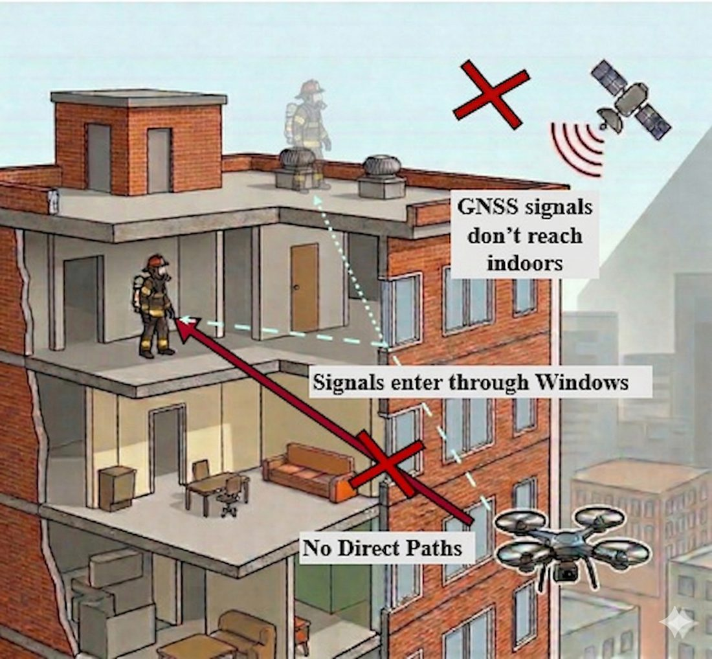
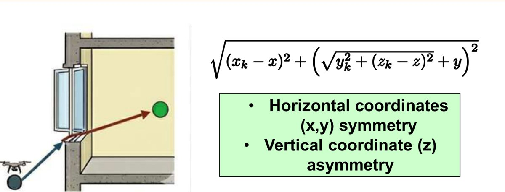
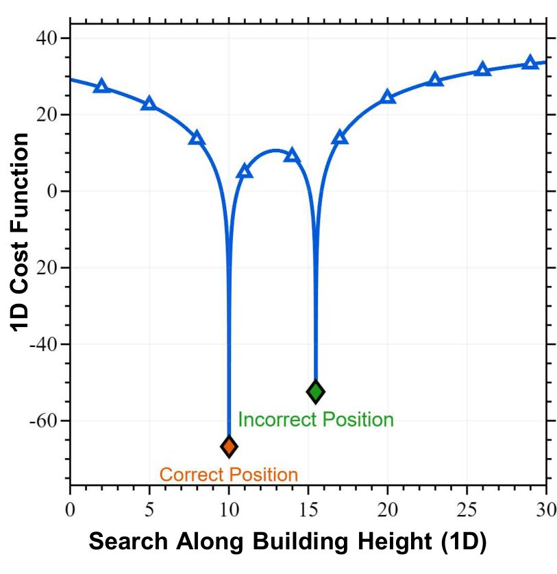
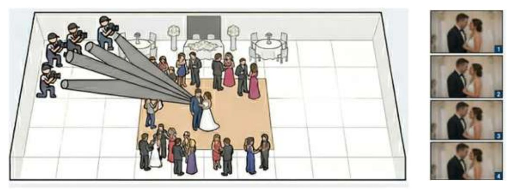
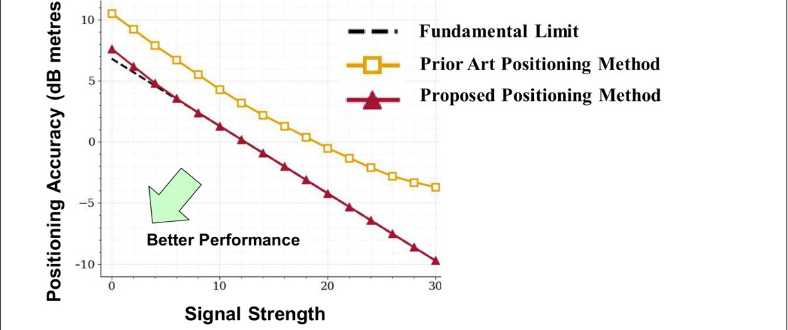
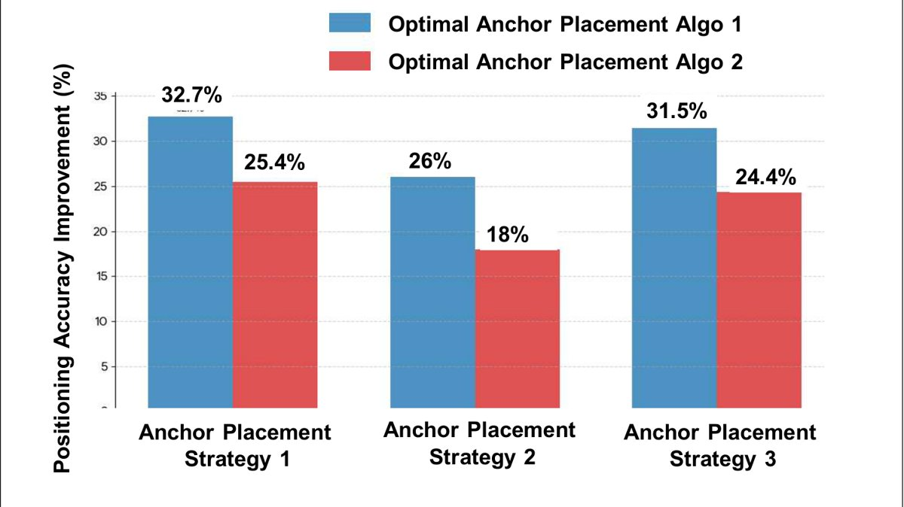

<!-- ============================ HERO ============================ -->
<section class="gd-hero">
  

    
Wireless Systems Engineer &middot; Apple

    <h1 class="gd-name">Gaurav Duggal</h1>
    

      I work on wireless systems that have to hold up in the real world. At Apple I build
      RF front-end systems for cellular connectivity. In my PhD at Virginia Tech, I worked out how
      to find people inside buildings using radio signals that <em>bend around window edges</em>.
    

    <ul class="gd-facts">
      <li><i class="fa-solid fa-graduation-cap"></i> PhD, ECE, Virginia Tech (Wireless@VT), 2021&ndash;2026</li>
      <li><i class="fa-solid fa-trophy"></i> Torgersen Research Excellence Award, 1st place PhD, 2026</li>
      <li><i class="fa-solid fa-award"></i> NIJ Graduate Research Fellow, 2023&ndash;2026</li>
    </ul>
    

      <a class="gd-btn gd-btn-primary" href="/assets/pdf/Gaurav_duggal_full_resume.pdf"><i class="fa-solid fa-file-lines"></i> CV</a>
      <a class="gd-btn" href="https://scholar.google.com/citations?user=OklRZKgAAAAJ"><i class="ai ai-google-scholar"></i> Scholar</a>
      <a class="gd-btn" href="https://www.linkedin.com/in/gaurav-duggal-09416157"><i class="fa-brands fa-linkedin"></i> LinkedIn</a>
      <a class="gd-btn" href="https://github.com/gauravduggal"><i class="fa-brands fa-github"></i> GitHub</a>
      <a class="gd-btn" href="mailto:gduggal1729@gmail.com"><i class="fa-solid fa-envelope"></i> Email</a>
    

  

  

    
  

</section>

<!-- ======================= TORGERSEN AWARD ======================= -->
<section class="gd-award">
  

    
<i class="fa-solid fa-trophy"></i> 1st place, PhD &middot; 2026

    <h2>Paul E. Torgersen Graduate Student Research Excellence Award</h2>
    

      Virginia Tech College of Engineering. I explain my whole PhD in five minutes in the video,
      and the poster sums it up on a single page.
    

    

      <a class="gd-btn gd-btn-light" href="/assets/pdf/Torgersen_Poster.pdf"><i class="fa-solid fa-file-pdf"></i> Poster (PDF)</a>
      <a class="gd-btn gd-btn-light" href="https://news.vt.edu/articles/2026/04/eng-coe-torgersen-research-winners-2026.html"><i class="fa-solid fa-newspaper"></i> VT News</a>
    

  

  

    <video controls preload="none" playsinline poster="/assets/img/research/poster_thumb.jpg">
      <source src="/assets/video/Gaurav_Duggal.mp4" type="video/mp4">
      <a href="/assets/video/Gaurav_Duggal.mp4">Watch the 5-minute video</a>
    </video>
  

</section>

<!-- ========================= PhD RESEARCH ========================= -->
<section class="gd-section" id="research">
  

    <h2>My PhD research</h2>
  

  <blockquote class="gd-question">
    How do you find someone when the direct wireless path to them is blocked?
  </blockquote>

  

    

      <h3>Why it matters</h3>
      

        When firefighters go into a building, knowing exactly where they are can save lives.
        But GPS is too weak indoors to help.
      

      

        One option is to fly drones (UAV anchors) outside the building and have them transmit
        signals in. The catch: walls block the direct path, so the signals mostly come in
        through the <strong>windows</strong>. Standard positioning methods assume signals travel
        in straight lines, so here they can be badly wrong, even putting a responder on the
        <strong>wrong floor</strong>.
      

      

        Thesis: <em>Wireless Localization in Next-Generation Emergency Networks</em>.
        Advised by Prof. Jeffrey H. Reed, Prof. R. Michael Buehrer and Prof. Harpreet S. Dhillon.
        Funded by a National Institute of Justice Graduate Research Fellowship ($166,500, 2023&ndash;2026).
      

    

    <figure class="gd-figure">
      
      <figcaption>The direct path is blocked, so the signal comes in through the windows.</figcaption>
    </figure>
  

  <h3 class="gd-subhead">Three ideas</h3>
  

    <article class="gd-card">
      1
      <h4>Model how the signal bends</h4>
      
      

        Radio waves pass through glass as if it isn't there, so the signal <em>bends around the window
        edge</em> (diffraction) and then travels into the room. Working from electromagnetic field theory,
        I derived the length of this bent path and the best accuracy any method could achieve.
      

      
Key insight: the model treats left/right the same, but not up/down.

    </article>

    <article class="gd-card">
      2
      <h4>Turn a hard 3D search into an easy 1D one</h4>
      
      

        Searching every 3D point is slow and can get stuck on the wrong answer. Because of that symmetry,
        for each candidate height the best horizontal position has a closed-form solution. That leaves
        a 1D search over height, where the right answer is easy to pick out.
      

      
<strong>~35%</strong> lower positioning error than prior methods, and it hits the theoretical limit at moderate to high signal strength.

    </article>

    <article class="gd-card">
      3
      <h4>Place the anchors for a whole region</h4>
      
      

        Picture photographers at a wedding: bunched together, they all get the same shot, and if that
        angle is bad, every photo is bad. Spreading them out helps, but where do you put them if you don't
        know where the subject is? Anchor placement has the same chicken-and-egg problem. I solved it by
        placing anchors to work well across an <em>entire indoor region</em>, not just one point.
      

      
<strong>18&ndash;30%</strong> better positioning than benchmark placement strategies.

    </article>
  

  

    <figure class="gd-figure">
      
      <figcaption>The proposed method (red) vs. prior art (gold) and the fundamental limit (dashed). Lower is better.</figcaption>
    </figure>
    <figure class="gd-figure">
      
      <figcaption>How much the two optimal placement algorithms improve on three benchmark strategies.</figcaption>
    </figure>
  

  

    <strong>The big picture:</strong> diffraction is usually treated as a problem to work around. My work shows
    it can be modeled and <em>used</em> as information for accurate indoor localization. The next step is
    a testbed to validate the results in the field.
  

</section>

<!-- ========================== BACKGROUND ========================== -->
<section class="gd-section" id="background">
  

    <h2>Background</h2>
    <a class="gd-more" href="/cv/">Full CV &rarr;</a>
  

  

    

      <h3 class="gd-subhead">Experience</h3>
      <ul class="gd-timeline">
        <li>2026&ndash;now<strong>Apple</strong>, Wireless Systems Engineer RF front-end systems for cellular connectivity</li>
        <li>2025<strong>NXP Semiconductors</strong>, ML &amp; Signal Processing Research Intern</li>
        <li>2022, 2023<strong>Samsung Research America</strong>, Research Intern</li>
        <li>2019&ndash;2021<strong>Qualcomm</strong>, RF Software Engineer</li>
      </ul>
    

    

      <h3 class="gd-subhead">Education</h3>
      <ul class="gd-timeline">
        <li>2021&ndash;2026<strong>Virginia Tech</strong>, PhD, Electrical &amp; Computer Engineering Wireless@VT</li>
        <li>2017&ndash;2019<strong>IIIT Delhi</strong>, M.Tech., Communications &amp; Signal Processing Automotive radar signal processing with Prof. Shobha Sundar Ram</li>
        <li>2009&ndash;2013<strong>BITS Pilani, Hyderabad</strong>, B.E. (Hons.), Electrical &amp; Electronics Engineering</li>
      </ul>
    

  

  <h3 class="gd-subhead">Research interests</h3>
  <ul class="gd-tags">
    <li>Wireless positioning &amp; localization</li>
    <li>Diffraction-aided positioning in NLOS</li>
    <li>Optimal anchor placement</li>
    <li>Estimation theory</li>
    <li>5G positioning</li>
    <li>Joint radar-communications</li>
  </ul>

  
<i class="fa-solid fa-bicycle"></i> Outside work I tinker with electronics and race bikes.

</section>

<!-- ============================ AWARDS ============================ -->
<section class="gd-section" id="awards">
  

    <h2>Awards &amp; honors</h2>
  

  <ul class="gd-awards">
    <li class="gd-awards-top">
      2026
      
<strong>Paul E. Torgersen Graduate Student Research Excellence Award, 1st place PhD</strong>, Virginia Tech College of Engineering
        <a href="https://news.vt.edu/articles/2026/04/eng-coe-torgersen-research-winners-2026.html">VT News</a> &middot; <a href="/assets/video/Gaurav_Duggal.mp4">video</a> &middot; <a href="/assets/pdf/Torgersen_Poster.pdf">poster</a>

    </li>
    <li class="gd-awards-top">
      2023&ndash;26
      
<strong>NIJ FY23 Graduate Research Fellowship ($166,500)</strong>, U.S. Department of Justice, for &ldquo;Next Generation Emergency Networks&rdquo;
        <a href="https://nij.ojp.gov/funding/fellowships/graduate-research-fellowship-program-past-and-present-fellows">NIJ fellows</a>

    </li>
    <li>2026
<strong>Pratt Fellowship</strong> ($1,000), Virginia Tech
</li>
    <li>2024, 2025
<strong>Commonwealth Cyber Initiative Cyber Innovation Scholar</strong> ($2,000/yr)
</li>
    <li>2023
<strong>IEEE ComSoc Travel Grant</strong> ($1,250)
</li>
    <li>2022
<strong>Qualcomm Innovation Fellowship, finalist</strong>, for &ldquo;Joint radar-communication based wireless localisation&rdquo;
</li>
  </ul>
</section>
