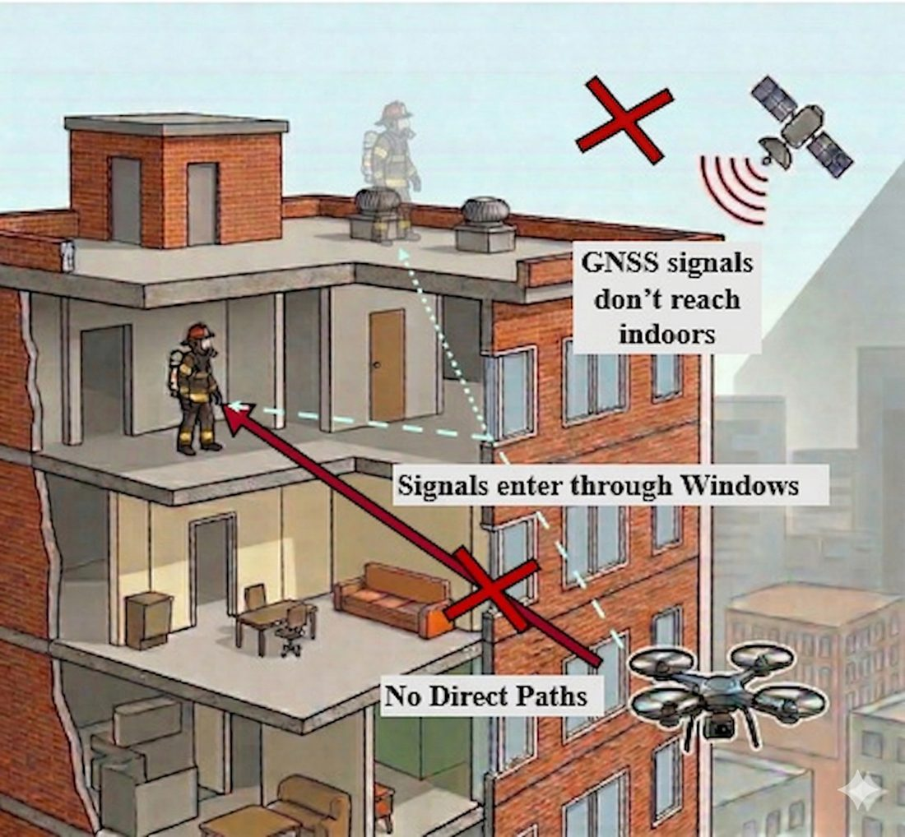
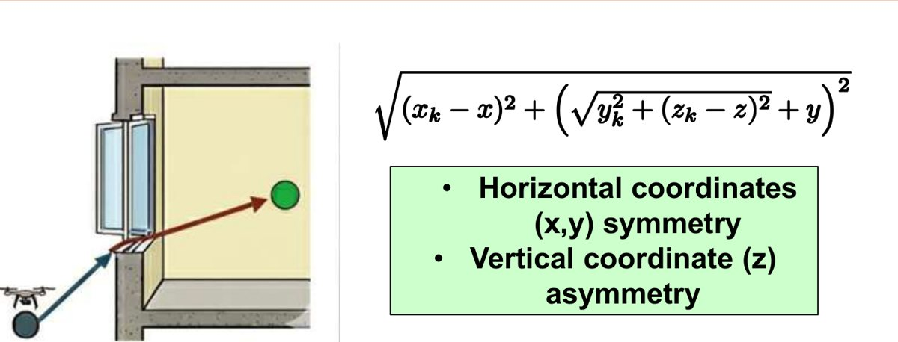
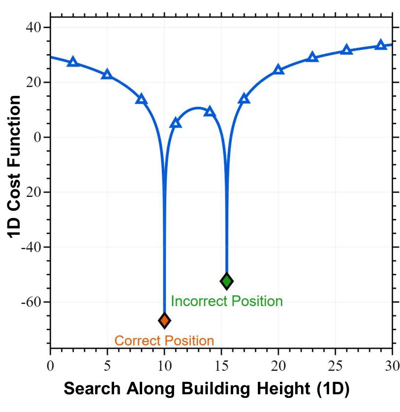
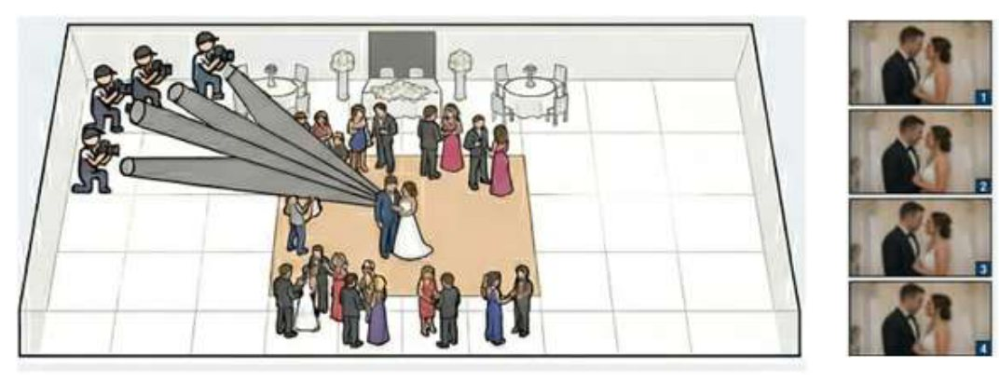
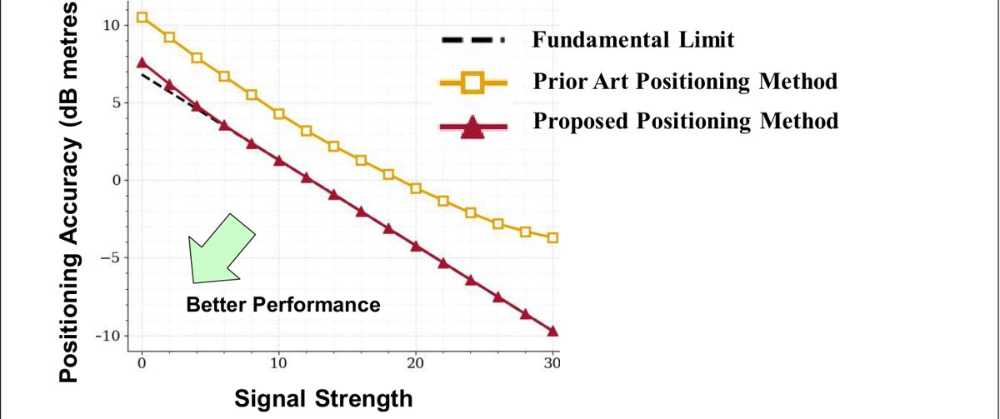
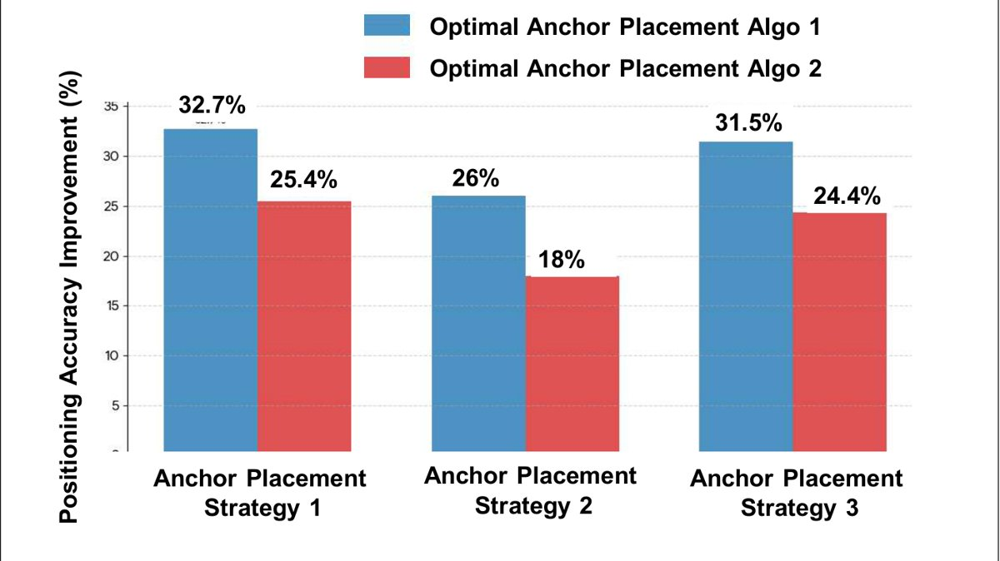

<!-- ======================= TORGERSEN AWARD ======================= -->
<section class="gd-award">
  

    
<i class="fa-solid fa-trophy"></i> 1st place, PhD &middot; 2026

    <h2>Paul E. Torgersen Graduate Student Research Excellence Award</h2>
    

      Virginia Tech College of Engineering. I explain my whole PhD in five minutes in the video,
      and the poster sums it up on a single page.
    

    

      <a class="gd-btn gd-btn-light" href="/assets/pdf/Torgersen_Poster.pdf"><i class="fa-solid fa-file-pdf"></i> Poster (PDF)</a>
      <a class="gd-btn gd-btn-light" href="https://news.vt.edu/articles/2026/04/eng-coe-torgersen-research-winners-2026.html"><i class="fa-solid fa-newspaper"></i> VT News</a>
    

  

  

    <video controls preload="none" playsinline poster="/assets/img/research/poster_thumb.jpg">
      <source src="/assets/video/Gaurav_Duggal.mp4" type="video/mp4">
      <a href="/assets/video/Gaurav_Duggal.mp4">Watch the 5-minute video</a>
    </video>
  

</section>

<!-- ========================= PhD RESEARCH ========================= -->
<section class="gd-section gd-section-first" id="research">

  <blockquote class="gd-question">
    How do you find someone when the direct wireless path to them is blocked?
  </blockquote>

  

    

      <h3>Why it matters</h3>
      

        When firefighters go into a building, knowing exactly where they are can save lives.
        But GPS is too weak indoors to help.
      

      

        One option is to fly drones (UAV anchors) outside the building and have them transmit
        signals in. The catch: walls block the direct path, so the signals mostly come in
        through the <strong>windows</strong>. Standard positioning methods assume signals travel
        in straight lines, so here they can be badly wrong, even putting a responder on the
        <strong>wrong floor</strong>.
      

      

        Thesis: <em>Wireless Localization in Next-Generation Emergency Networks</em>.
        Advised by <a href="https://ece.vt.edu/people/profile/reed.html">Prof. Jeffrey H. Reed</a>, <a href="https://ece.vt.edu/people/profile/buehrer.html">Prof. R. Michael Buehrer</a> and <a href="https://www.dhillon.ece.vt.edu/">Prof. Harpreet S. Dhillon</a>.
        Funded by a <a href="https://nij.ojp.gov/funding/awards/15pnij-23-gg-01949-ress">National Institute of Justice Graduate Research Fellowship</a> ($166,500, 2023&ndash;2026; <a href="https://nij.ojp.gov/funding/fellowships/graduate-research-fellowship-program-past-and-present-fellows">NIJ fellows list</a>).
      

    

    <figure class="gd-figure">
      
      <figcaption>The direct path is blocked, so the signal comes in through the windows.</figcaption>
    </figure>
  

  <h3 class="gd-subhead">Three ideas</h3>
  

    <article class="gd-card">
      1
      <h4>Model how the signal bends</h4>
      
      

        Radio waves pass through glass as if it isn't there, so the signal <em>bends around the window
        edge</em> (diffraction) and then travels into the room. Working from electromagnetic field theory,
        I derived the length of this bent path and the best accuracy any method could achieve.
      

      
Key insight: the model treats left/right the same, but not up/down.

    </article>

    <article class="gd-card">
      2
      <h4>Turn a hard 3D search into an easy 1D one</h4>
      
      

        Searching every 3D point is slow and can get stuck on the wrong answer. Because of that symmetry,
        for each candidate height the best horizontal position has a closed-form solution. That leaves
        a 1D search over height, where the right answer is easy to pick out.
      

      
<strong>~35%</strong> lower positioning error than prior methods, and it hits the theoretical limit at moderate to high signal strength.

    </article>

    <article class="gd-card">
      3
      <h4>Place the anchors for a whole region</h4>
      
      

        Picture photographers at a wedding: bunched together, they all get the same shot, and if that
        angle is bad, every photo is bad. Spreading them out helps, but where do you put them if you don't
        know where the subject is? Anchor placement has the same chicken-and-egg problem. I solved it by
        placing anchors to work well across an <em>entire indoor region</em>, not just one point.
      

      
<strong>18&ndash;30%</strong> better positioning than benchmark placement strategies.

    </article>
  

  

    <figure class="gd-figure">
      
      <figcaption>The proposed method (red) vs. prior art (gold) and the fundamental limit (dashed). Lower is better.</figcaption>
    </figure>
    <figure class="gd-figure">
      
      <figcaption>How much the two optimal placement algorithms improve on three benchmark strategies.</figcaption>
    </figure>
  

  

    <strong>The big picture:</strong> diffraction is usually treated as a problem to work around. My work shows
    it can be modeled and <em>used</em> as information for accurate indoor localization. The next step is
    a testbed to validate the results in the field.
  

</section>

<!-- ======================== M.TECH THESIS ======================== -->
<section class="gd-section" id="mtech">
  

    <h2>Before my PhD: automotive radar</h2>
  

  

    
M.Tech. thesis &middot; IIIT Delhi &middot; 2017&ndash;2019

    <h3><em>Automotive Radar Signal Processing</em></h3>
    

      M.Tech. in Communications and Signal Processing, advised by <a href="https://sites.google.com/iiitd.ac.in/shobhasundarram">Prof. Shobha Sundar Ram</a>.
    

    

      My thesis made the IEEE 802.11ad waveform (the 60&nbsp;GHz Wi-Fi standard) <strong>Doppler-resilient</strong>,
      so it holds up when the car and its surroundings are moving, and then designed an automotive radar with it.
      Because the waveform is also a communication signal, the result is a joint radar-communications system.
      I also used the radar to detect the <strong>micro-Doppler and micro-range</strong> signatures of pedestrians.
    

    <ul class="gd-paperlist">
      <li>
        <a href="https://doi.org/10.1109/TAES.2020.2990393">Doppler-resilient 802.11ad-based ultrashort range automotive joint radar-communications system</a>
        &middot; IEEE Transactions on Aerospace and Electronic Systems, 2020
      </li>
      <li>
        <a href="https://doi.org/10.1109/RADAR.2019.8835525">Micro-Doppler and micro-range detection via Doppler-resilient 802.11ad-based vehicle-to-pedestrian radar</a>
        &middot; IEEE Radar Conference (RadarConf), 2019
      </li>
    </ul>
  

</section>

